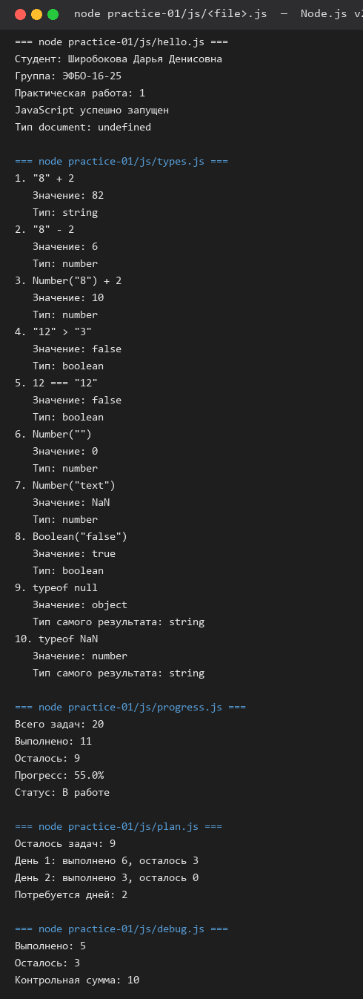
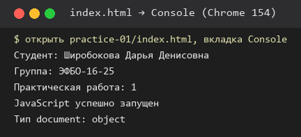
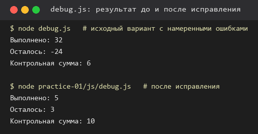
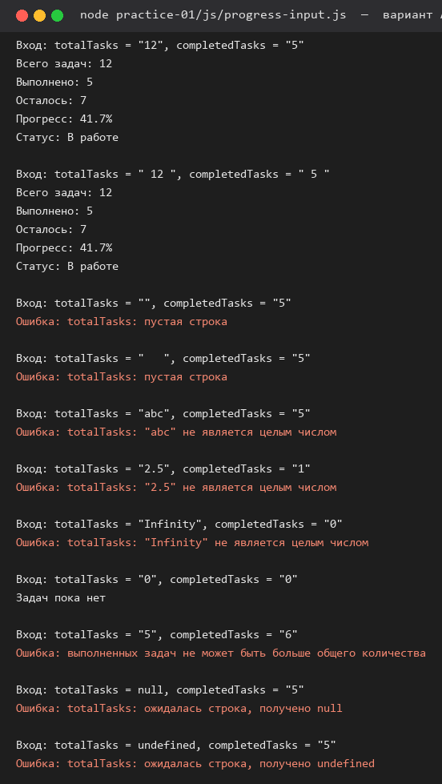

# Практическая работа № 1. Основы JavaScript

## 1. Автор и вариант

| Поле | Значение |
|---|---|
| Имя | Широбокова Дарья Денисовна |
| Группа | ЭФБО-16-25 |
| Вариант | 4 |
| Данные варианта | `totalTasks = 20`, `completedTasks = 11`, `dailyLimit = 6` |

Вариант определён по номеру в журнале: `variant = ((N - 1) % 8) + 1`. Общие проверочные
примеры из методички выполняются дополнительно к данным варианта.

## 2. Окружение

Фактические значения, полученные командами `node --version`, `npm --version`, `git --version`:

| Инструмент | Значение |
|---|---|
| Операционная система | Windows 11 (10.0.26300) |
| Node.js | v24.21.0 (учебная ветка 24 LTS) |
| npm | 11.19.0 |
| Git | 2.56.0.windows.2 |
| Браузер | Google Chrome 154.0.8037.98 |

## 3. Запуск

Все команды выполняются из корня личного репозитория `tip-js-practices`:

```bash
node practice-01/js/hello.js
node practice-01/js/types.js
node practice-01/js/progress.js
node practice-01/js/plan.js
node practice-01/js/debug.js
node practice-01/js/progress-input.js   # дополнительное задание, вариант А
```

Запуск в браузере: открыть `practice-01/index.html` как локальный файл (в ПР1 нет ES-модулей,
поэтому сервер не требуется), заменить путь в `<script src>`, сохранить файл, перезагрузить
страницу и открыть вкладку **Console**. Сейчас подключён `./js/hello.js` — это состояние,
в котором работа сдаётся.

## 4. Задание 1. Один файл — две среды выполнения

Файл `js/hello.js` со своими данными запущен двумя способами.

**Node.js** — `node practice-01/js/hello.js`:

```text
Студент: Широбокова Дарья Денисовна
Группа: ЭФБО-16-25
Практическая работа: 1
JavaScript успешно запущен
Тип document: undefined
```

**Браузер** — `index.html` открыт локально, вывод в Console:

```text
Студент: Широбокова Дарья Денисовна
Группа: ЭФБО-16-25
Практическая работа: 1
JavaScript успешно запущен
Тип document: object
```

| Что сравнить | Node.js | Браузер |
|---|---|---|
| Способ запуска | `node practice-01/js/hello.js` | открыт `index.html`, вкладка Console |
| Где появился вывод | терминал | консоль DevTools, не на странице |
| Последняя строка | `Тип document: undefined` | `Тип document: object` |

**Различие.** `document` — объект браузерной среды: он описывает HTML-страницу. Node.js
выполняет тот же JavaScript, но HTML-документ не создаёт и DOM не предоставляет, поэтому
обращение к `document` даёт `undefined`. Первые четыре строки совпадают: сам язык и функция
`console.log()` в обеих средах одинаковы.

Подтверждение запуска всех пяти обязательных файлов в Node.js:





## 5. Задание 2. Типы и преобразования

Файл `js/types.js`. Для каждого выражения прогноз записан до запуска, затем проверен.

| Выражение | Ожидание до запуска | Фактическое значение | Тип результата | Объяснение |
|---|---|---|---|---|
| `"8" + 2` | `"82"` | `82` | `string` | Оператор `+` со строкой выполняет конкатенацию: число 2 преобразуется в текст и приклеивается. |
| `"8" - 2` | `6` | `6` | `number` | Оператора вычитания для строк не существует, поэтому строка преобразуется в число. |
| `Number("8") + 2` | `10` | `10` | `number` | Явное преобразование до сложения: складываются два числа. |
| `"12" > "3"` | `false` | `false` | `boolean` | Обе стороны — строки, сравнение посимвольное: `"1"` меньше `"3"`. |
| `12 === "12"` | `false` | `false` | `boolean` | Строгое равенство не приводит типы и сразу даёт `false` для разных типов. |
| `Number("")` | `0` | `0` | `number` | Пустая строка — особый случай `Number()`; поэтому пустой ввод нужно проверять отдельно. |
| `Number("text")` | `NaN` | `NaN` | `number` | Преобразование невозможно, но `typeof NaN` равно `number`, одного `typeof` мало. |
| `Boolean("false")` | `true` | `true` | `boolean` | Непустая строка всегда истинна; текст `"false"` командой не является. |
| `typeof null` | `"object"` | `object` | `string` | Историческая особенность языка: значение `typeof null` — строка `"object"`. |
| `typeof NaN` | `"number"` | `number` | `string` | `NaN` относится к числовому типу, поэтому проверяют `Number.isFinite`. |

Файл запускается и в Node.js, и в браузере: он не использует браузерных API.

## 6. Задание 3. Сводка выполнения задач

Файл `js/progress.js`. Входные данные варианта 4: `totalTasks = 20`, `completedTasks = 11`.
Проверки идут в порядке «тип и целочисленность → границы → частные случаи», расчёт процента
не выполняется при недопустимых данных.

Вывод для данных варианта:

```text
Всего задач: 20
Выполнено: 11
Осталось: 9
Прогресс: 55.0%
Статус: В работе
```

Обязательные проверки (для каждой менялись константы в начале файла и запускался `node`):

| `totalTasks` | `completedTasks` | Ожидаемое поведение | Фактический результат | Итог |
|---:|---:|---|---|---|
| `12` | `5` | Осталось 7; `41.7%`; «В работе» | Осталось 7; Прогресс: 41.7%; Статус: В работе | Пройдено |
| `0` | `0` | «Задач пока нет», процент не считается | Задач пока нет | Пройдено |
| `5` | `0` | Осталось 5; `0.0%`; «Не начато» | Осталось 5; Прогресс: 0.0%; Статус: Не начато | Пройдено |
| `5` | `5` | Осталось 0; `100.0%`; «Завершено» | Осталось 0; Прогресс: 100.0%; Статус: Завершено | Пройдено |
| `5` | `6` | Ошибка: выполнено больше, чем существует | Ошибка: выполненных задач не может быть больше общего количества | Пройдено |
| `-1` | `0` | Ошибка: отрицательное количество | Ошибка: общее количество задач должно быть в диапазоне от 0 до 1000 | Пройдено |
| `5` | `2.5` | Ошибка: дробное количество | Ошибка: количество задач должно быть целым числом | Пройдено |
| `"5"` | `2` | Ошибка: вместо числа передана строка | Ошибка: количество задач должно быть целым числом | Пройдено |
| `1001` | `0` | Ошибка: превышена верхняя граница | Ошибка: общее количество задач должно быть в диапазоне от 0 до 1000 | Пройдено |
| `NaN` | `0` | Ошибка: недопустимое числовое значение | Ошибка: количество задач должно быть целым числом | Пройдено |

Деления на ноль нет: случай `0 / 0` обрабатывается отдельной ветвью до расчёта процента.

## 7. Задание 4. План выполнения задач по дням

Файл `js/plan.js`. Данные варианта 4: `totalTasks = 20`, `completedTasks = 11`, `dailyLimit = 6`.

```text
Осталось задач: 9
День 1: выполнено 6, осталось 3
День 2: выполнено 3, осталось 0
Потребуется дней: 2
```

Обязательные проверки:

| `totalTasks` | `completedTasks` | `dailyLimit` | Ожидаемое поведение | Фактический результат | Итог |
|---:|---:|---:|---|---|---|
| `12` | `5` | `3` | 3 дня; в последний день 1 задача | День 1: 3, День 2: 3, День 3: 1; дней: 3 | Пройдено |
| `10` | `4` | `3` | 2 дня по 3 задачи | Осталось 6; День 1: 3, День 2: 3; дней: 2 | Пройдено |
| `5` | `3` | `10` | 1 день, только 2 оставшиеся задачи | День 1: выполнено 2; дней: 1 | Пройдено |
| `5` | `5` | `2` | 0 дней; цикл не выполняется | Все задачи уже выполнены; Потребуется дней: 0 | Пройдено |
| `0` | `0` | `2` | 0 дней; цикл не выполняется | Все задачи уже выполнены; Потребуется дней: 0 | Пройдено |
| `5` | `2` | `0` | Ошибка; цикл не запускается | Ошибка: дневная норма должна быть целым числом от 1 до 1000 | Пройдено |
| `5` | `2` | `1.5` | Ошибка: дробная норма | Ошибка: дневная норма должна быть целым числом от 1 до 1000 | Пройдено |
| `5` | `6` | `2` | Ошибка: некорректное число выполненных | Ошибка: выполненных задач не может быть больше общего количества | Пройдено |
| `5` | `2` | `"2"` | Ошибка: норма задана строкой | Ошибка: дневная норма должна быть целым числом от 1 до 1000 | Пройдено |
| `5` | `2` | `1001` | Ошибка: превышена верхняя граница | Ошибка: дневная норма должна быть целым числом от 1 до 1000 | Пройдено |

Остаток не становится отрицательным: на последнем дне используется `Math.min(dailyLimit, remainingTasks)`.
Проверка `dailyLimit` выполняется до цикла, поэтому недопустимая норма не приводит к зацикливанию.

## 8. Задание 5. Поиск логических ошибок

Стартовый вариант `js/debug.js` был запущен до исправления, его фактический вывод:

```text
Выполнено: 32
Осталось: -24
Контрольная сумма: 6
```

Исключения не возникло, но результат неверный. После исправления:

```text
Выполнено: 5
Осталось: 3
Контрольная сумма: 10
```

| Ошибка | Что наблюдалось | Причина | Исправление | Результат после исправления |
|---|---|---|---|---|
| Обработка количества задач | `Выполнено: 32`, `Осталось: -24` | `completedText + additionalText` — это конкатенация строк `"3" + "2" = "32"`, а `"8" - "32"` даёт `-24` | Оба количества явно преобразованы: `Number(completedText) + Number(additionalText)` и `Number(plannedText) - completedTotal` | `Выполнено: 5`, `Осталось: 3` |
| Граница цикла | `Контрольная сумма: 6` вместо 10 | Условие `taskNumber < 4` останавливает цикл на 3, четвёртая задача не учитывается | Условие изменено на `taskNumber <= 4` | `Контрольная сумма: 10` |

Отладка выполнялась в DevTools: точка останова ставилась на строке вычисления `completedTotal`,
значения и типы `completedText` и `additionalText` проверялись в панели **Scope** (`"3"` и `"2"`,
оба `string`), затем после **Step over** исследовалось значение `completedTotal` (`"32"`, `string`).
Вторая точка останова внутри цикла показала, что последняя итерация выполняется при
`taskNumber = 3` и `controlSum = 6`.

Значения не заменялись константами: исправлены именно преобразование типов и граница цикла.



## 9. Дополнительное задание, вариант А: данные поступают строками

Файл `js/progress-input.js`. Количества приходят строками: сначала проверяется тип, затем
`trim()`, затем пустой ввод, затем `Number()` и правила задания 3.

Проверок типа `Number()` недостаточно: `Number("")` и `Number("   ")` дают `0`, поэтому пустой
ввод выглядел бы как «Задач пока нет»; `Number("Infinity")` даёт бесконечность, которая является
числом, а `Number("2.5")` — дробное значение; кроме того, `Number()` принимает запись вида
`0x10` или `1e3`. Поэтому проверки выполняются по шагам: тип → непустая строка после `trim()`
→ `Number.isInteger`.

| Вход `totalTasks` | Вход `completedTasks` | Ожидание | Фактический результат |
|---|---|---|---|
| `"12"` | `"5"` | Сводка: 41.7%, «В работе» | Всего задач: 12; Осталось: 7; Прогресс: 41.7%; Статус: В работе |
| `" 12 "` | `" 5 "` | Краевые пробелы удаляются | Всего задач: 12; Прогресс: 41.7%; Статус: В работе |
| `""` | `"5"` | Отказ, а не ноль задач | Ошибка: totalTasks: пустая строка |
| `"   "` | `"5"` | Отказ, строка из пробелов пуста | Ошибка: totalTasks: пустая строка |
| `"abc"` | `"5"` | Отказ: не число | Ошибка: totalTasks: "abc" не является целым числом |
| `"2.5"` | `"1"` | Отказ: дробное | Ошибка: totalTasks: "2.5" не является целым числом |
| `"Infinity"` | `"0"` | Отказ: не конечное целое | Ошибка: totalTasks: "Infinity" не является целым числом |
| `"0"` | `"0"` | «Задач пока нет» | Задач пока нет |
| `"5"` | `"6"` | Отказ: выполнено больше общего | Ошибка: выполненных задач не может быть больше общего количества |
| `null` | `"5"` | Отказ без исключения | Ошибка: totalTasks: ожидалась строка, получено null |
| `undefined` | `"5"` | Отказ без исключения | Ошибка: totalTasks: ожидалась строка, получено undefined |

Ни один некорректный ввод не привёл к необработанному исключению.



## 10. Вывод

Освоены запуск одного и того же кода в двух средах, типы и явное преобразование, условия с
проверкой целочисленности и границ, цикл `while` с пошаговым планом и отладка через точки
останова. Наиболее показательной оказалась ошибка в `debug.js`: программа выполнилась без
исключения, но из-за конкатенации строк выдала `32` и `-24`. Это подтверждает, что отсутствие
ошибки в консоли не доказывает правильность расчёта, а тип значения нужно проверять отдельно
от самого значения.

## 11. Самопроверка

- [x] Один и тот же файл работает в Node.js и браузере, различие `typeof document` объяснено.
- [x] Проверены все десять выражений задания 2 с объяснениями.
- [x] Задания 3 и 4 проверены на обычных, граничных и некорректных данных.
- [x] Ошибочные данные дают сообщение `Ошибка: ...` без обычной сводки.
- [x] Деления на ноль нет, остаток не становится отрицательным.
- [x] Обе ошибки `debug.js` исправлены без подстановки готовых констант.
- [x] Выполнено расширение варианта А с собственными проверками.
- [x] В `index.html` возвращено подключение `./js/hello.js`.
