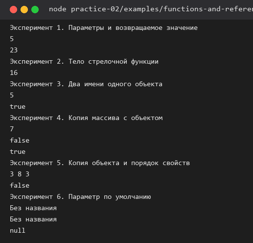
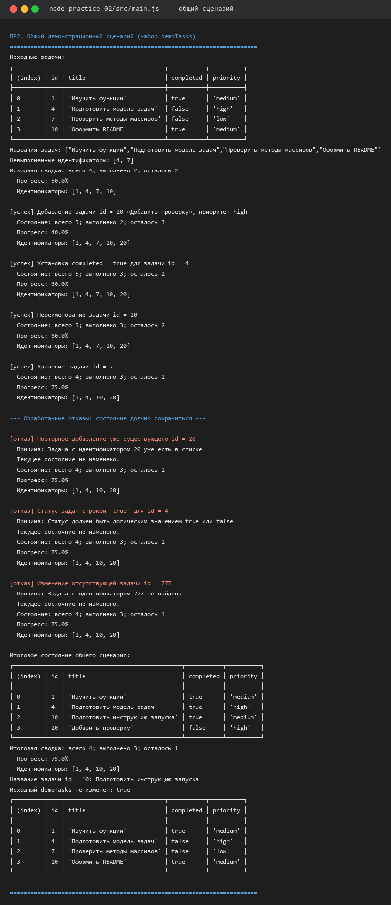
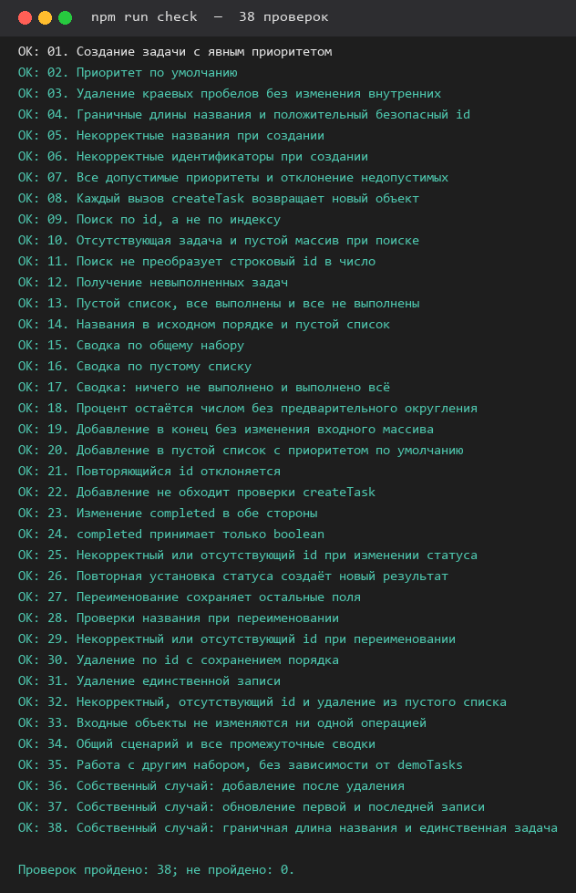
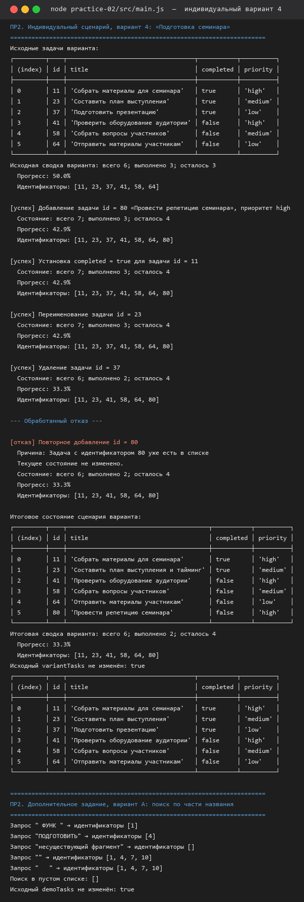

# Отчёт по практической работе № 2

**Тема:** Функции, объекты, массивы и организация кода

## 1. Автор и окружение

| Поле | Значение |
|---|---|
| Имя | Широбокова Дарья Денисовна |
| Группа | ЭФБО-16-25 |
| Вариант | 4 |
| Операционная система | Windows 11 (10.0.26300) |
| Node.js | v24.21.0 |
| npm | 11.19.0 |
| Git | 2.56.0.windows.2 |

## 2. Запуск

Из корня личного репозитория `tip-js-practices`:

```bash
node practice-02/examples/functions-and-references.js
node practice-02/src/main.js
node practice-02/checks.js
```

Альтернатива — из папки `practice-02`:

```bash
npm run examples
npm start
npm run check
```

Зависимостей нет; `npm install` не требуется. Ниже приведены фактические результаты этих команд.

## 3. Функции, ссылки и копирование

Прогнозы записаны до запуска, затем файл выполнен и результаты сверены.

| № | Прогноз до запуска | Фактический результат | Причина |
|---:|---|---|---|
| 1 | `sum(2, 3)` → `5`; `sum("2", 3)` → `"23"` | `5`, затем `23` (строка) | `+` со строкой выполняет конкатенацию, функция аргументы не преобразует. |
| 2 | `undefined`, потому что в теле с фигурными скобками нет `return` | `undefined` | Выражение `value * value` вычисляется, но не возвращается: результат теряется. |
| 3 | `5` и `true` | `5`, `true` | `alias` и `product` — два имени одного объекта; `const` запрещает переприсваивание переменной, но не изменение свойства. |
| 4 | `7`, `false`, `true` | `7`, `false`, `true` | `[...products]` создаёт новый массив, но объекты внутри те же: изменение `copy[0]` видно в `products[0]`. |
| 5 | `3 8 3`, затем `false` | `3 8 3`, `false` | В `first` свойство `stock: 8` стоит после spread и перекрывает исходное; в `second` spread идёт последним и возвращает `3`. |
| 6 | «Без названия», «Без названия», `null`, пустая строка | `Без названия`, `Без названия`, `null`, пустая строка | Значение по умолчанию применяется только для пропущенного аргумента и `undefined`; `null` и `""` его не включают. |

**Исправление эксперимента 2.** Исходный вариант возвращал `undefined`, потому что краткий
возврат работает только без фигурных скобок. В тело добавлен `return value * value;`,
после чего `square(4)` даёт число `16`. Результат до исправления — `undefined`,
после — `16`.



## 4. Модель данных и функции

Задача — плоский объект из четырёх полей:

| Поле | Правило |
|---|---|
| `id` | число, `Number.isSafeInteger(id)` и `id > 0`; строка `"4"` не преобразуется в число |
| `title` | строка; после `trim()` длина 1…100; в объект записывается очищенная строка |
| `completed` | строго логическое значение; при создании всегда `false` |
| `priority` | `"low"`, `"medium"` или `"high"`; по умолчанию `"medium"` |

| Файл | Ответственность |
|---|---|
| `src/data.js` | общий набор `demoTasks`, номер варианта и `variantTasks`; работы с DOM нет |
| `src/task-service.js` | девять прикладных функций; нет `console.log`, DOM и глобального списка |
| `src/task-extra.js` | расширение: поиск по части названия |
| `src/main.js` | последовательность действий, вывод и обработка отказов |
| `checks.js` | 35 готовых проверок и 3 собственных случая |

Операции изменения возвращают `{ ok: true, tasks }` либо `{ ok: false, error }`;
операции чтения возвращают объект задачи, массив или сводку, а отсутствие записи — `undefined`.

**Почему `id` не равен индексу:** идентификатор закреплён за записью и не меняется после
удаления соседней задачи, а индекс пересчитывается. В общем наборе `id` равны `1, 4, 7, 10`,
поэтому `tasks[4]` даёт `undefined`, хотя задача с `id = 4` есть — она на позиции `1`.

**Почему `getTaskStats` возвращает число:** процент — расчётная величина, округление нужно
только для вывода. Возврат числа позволяет переиспользовать сводку, а `toFixed(1)`
применяется в `main.js` при печати.

**Какие объекты копируются:** при изменении одной задачи создаётся новый массив и новый объект
именно этой задачи (`{ ...task, completed }`). Остальные записи переиспользуются: их свойства
не изменяются. Проверки 33 и 37 выполняются на `Object.freeze`, то есть мутация была бы ошибкой.

## 5. Общий демонстрационный сценарий

Команда `npm start` (или `node practice-02/src/main.js`). После каждого успешного действия
состояние заменяется массивом `result.tasks`, при отказе — сохраняется.

| Этап | Ожидание: всего / выполнено / осталось / прогресс | Фактический результат | Итог |
|---|---|---|---|
| Исходный набор | 4 / 2 / 2 / 50.0% | всего 4; выполнено 2; осталось 2; Прогресс: 50.0% | Совпало |
| Добавление `id = 20` | 5 / 2 / 3 / 40.0% | всего 5; выполнено 2; осталось 3; Прогресс: 40.0% | Совпало |
| Выполнение `id = 4` | 5 / 3 / 2 / 60.0% | всего 5; выполнено 3; осталось 2; Прогресс: 60.0% | Совпало |
| Переименование `id = 10` | 5 / 3 / 2 / 60.0% | всего 5; выполнено 3; осталось 2; Прогресс: 60.0% | Совпало |
| Удаление `id = 7` | 4 / 3 / 1 / 75.0% | всего 4; выполнено 3; осталось 1; Прогресс: 75.0% | Совпало |

**Идентификаторы итогового списка:** `[1, 4, 10, 20]`; название задачи `id = 10` —
`Подготовить инструкцию запуска`.

**Показанная ошибка:** повторное добавление `id = 20` напечатало
`Причина: Задача с идентификатором 20 уже есть в списке`, состояние осталось
`4 / 3 / 1 / 75.0%`. Дополнительно показаны отказ для статуса-строки `"true"`
и для отсутствующей задачи `id = 777`.

**Подтверждение неизменности:** после всех операций `console.table(demoTasks)` печатает
исходный набор, а строка `Исходный demoTasks не изменён: true` подтверждает совпадение.



## 6. Проверки

**Команда запуска:** `npm run check` из папки `practice-02` (или `node practice-02/checks.js`
из корня репозитория). **Дата запуска:** 12.10.2026, Node.js v24.21.0.

К готовым 35 сценариям добавлены три собственных (36–38), поэтому фактически пройдено 38.

```text
OK: 01. Создание задачи с явным приоритетом
OK: 02. Приоритет по умолчанию
OK: 03. Удаление краевых пробелов без изменения внутренних
OK: 04. Граничные длины названия и положительный безопасный id
OK: 05. Некорректные названия при создании
OK: 06. Некорректные идентификаторы при создании
OK: 07. Все допустимые приоритеты и отклонение недопустимых
OK: 08. Каждый вызов createTask возвращает новый объект
OK: 09. Поиск по id, а не по индексу
OK: 10. Отсутствующая задача и пустой массив при поиске
OK: 11. Поиск не преобразует строковый id в число
OK: 12. Получение невыполненных задач
OK: 13. Пустой список, все выполнены и все не выполнены
OK: 14. Названия в исходном порядке и пустой список
OK: 15. Сводка по общему набору
OK: 16. Сводка по пустому списку
OK: 17. Сводка: ничего не выполнено и выполнено всё
OK: 18. Процент остаётся числом без предварительного округления
OK: 19. Добавление в конец без изменения входного массива
OK: 20. Добавление в пустой список с приоритетом по умолчанию
OK: 21. Повторяющийся id отклоняется
OK: 22. Добавление не обходит проверки createTask
OK: 23. Изменение completed в обе стороны
OK: 24. completed принимает только boolean
OK: 25. Некорректный или отсутствующий id при изменении статуса
OK: 26. Повторная установка статуса создаёт новый результат
OK: 27. Переименование сохраняет остальные поля
OK: 28. Проверки названия при переименовании
OK: 29. Некорректный или отсутствующий id при переименовании
OK: 30. Удаление по id с сохранением порядка
OK: 31. Удаление единственной записи
OK: 32. Некорректный, отсутствующий id и удаление из пустого списка
OK: 33. Входные объекты не изменяются ни одной операцией
OK: 34. Общий сценарий и все промежуточные сводки
OK: 35. Работа с другим набором, без зависимости от demoTasks
OK: 36. Собственный случай: добавление после удаления
OK: 37. Собственный случай: обновление первой и последней записи
OK: 38. Собственный случай: граничная длина названия и единственная задача

Проверок пройдено: 38; не пройдено: 0.
```

Полный вывод сохранён в файле [`checks-output.txt`](./checks-output.txt).



### Собственные проверки

| Проверка | Входные данные | Ожидаемый результат | Фактический результат | Итог |
|---|---|---|---|---|
| 36. Добавление после удаления | `demoTasks`; удалить `id = 7`, затем добавить `id = 7` с названием «Возвращённая задача» | Идентификаторы `[1, 4, 10, 7]`, новая запись в конце, исходный массив не изменён | `[1, 4, 10, 7]`; запись `{ id: 7, title: "Возвращённая задача", completed: false, priority: "low" }`; промежуточный массив остался `[1, 4, 10]` | Пройдено |
| 37. Обновление первой и последней записи | Замороженный `demoTasks`; снять статус с `id = 1`, переименовать `id = 10` | 4 / 1 / 3 / 25%; `priority` первой записи сохранён; вторая запись не скопирована | 4 / 1 / 3 / 25%; `current[0].priority = "medium"`; `current[1] === tasks[1]`; исходные данные не изменены | Пройдено |
| 38. Граничная длина названия и единственная задача | Название из 100 символов и 101 символ; список из одной задачи | 100 — успех, 101 — отказ; переименование даёт новый объект; удаление единственной записи даёт `[]` | `ok: true` для 100 и `ok: false` для 101; `renamed[0] !== single[0]`; удаление вернуло `[]`, сводка `0 / 0 / 0 / 0` | Пройдено |

## 7. Индивидуальный вариант

**Предметная область:** подготовка семинара (вариант 4). Исходно выполнены первые `K = 3`
задачи из шести, приоритеты включают все три значения.

| `id` | Название | `completed` | `priority` |
|---:|---|---|---|
| 11 | Собрать материалы для семинара | `true` | `high` |
| 23 | Составить план выступления | `true` | `medium` |
| 37 | Подготовить презентацию | `true` | `low` |
| 41 | Проверить оборудование аудитории | `false` | `high` |
| 58 | Собрать вопросы участников | `false` | `medium` |
| 64 | Отправить материалы участникам | `false` | `low` |

Данные находятся в [`src/data.js`](./src/data.js); общий сценарий и сценарий варианта
выполняются одной командой `npm start` без ручной замены наборов.

| Этап | Ожидание до запуска | Фактический результат | Итог |
|---|---|---|---|
| Шесть исходных задач | 6 / 3 / 3 / 50.0% | всего 6; выполнено 3; осталось 3; Прогресс: 50.0% | Совпало |
| Добавление `id = 80` («Провести репетицию семинара», `high`) | 7 задач, 3 выполнено, 42.9% | всего 7; выполнено 3; осталось 4; Прогресс: 42.9%; запись в конце | Совпало |
| Установка `completed = true` для `id = 11` | Задача уже выполнена: успех, новый массив и новый объект | всего 7; выполнено 3; Прогресс: 42.9% | Совпало |
| Переименование `id = 23` | Меняется только название | `Составить план выступления и тайминг`; статус и приоритет сохранены | Совпало |
| Удаление `id = 37` | 6 задач, 2 выполнено, 33.3% | всего 6; выполнено 2; осталось 4; Прогресс: 33.3% | Совпало |
| Повторное добавление `id = 80` | Отказ без изменения списка | `Задача с идентификатором 80 уже есть в списке`; состояние `6 / 2 / 4 / 33.3%` | Совпало |

Итоговые идентификаторы варианта: `[11, 23, 41, 58, 64, 80]`.
Строка `Исходный variantTasks не изменён: true` подтверждает сохранность входного набора.



## 8. Расширение

Выполнено дополнительное задание, **вариант А**: поиск задач по части названия.
Модуль [`src/task-extra.js`](./src/task-extra.js) экспортирует `searchTasks(tasks, query)`:
запрос очищается через `trim()`, приводится к нижнему регистру, пустой запрос возвращает новый
массив всех задач, исходные записи не изменяются. Контракты девяти обязательных функций не
затронуты.

| Проверка | Входные данные | Ожидаемый результат | Фактический результат | Итог |
|---|---|---|---|---|
| Обычный запрос | `demoTasks`, `"ПОДГОТОВИТЬ"` | Совпадение без учёта регистра | идентификаторы `[4]` | Пройдено |
| Краевые пробелы | `demoTasks`, `" ФУНК "` | Пробелы удаляются | идентификаторы `[1]` | Пройдено |
| Нет совпадений | `demoTasks`, `"несуществующий фрагмент"` | Пустой массив | `[]` | Пройдено |
| Пустой и пробельный запрос | `demoTasks`, `""` и `"   "` | Новый массив всех задач | `[1, 4, 7, 10]` в обоих случаях | Пройдено |
| Пустой список | `[]`, `"задача"` | Пустой массив | `[]` | Пройдено |
| Сохранность данных | `demoTasks` после всех поисков | Исходный набор не изменён | `Исходный demoTasks не изменён: true` | Пройдено |

## 9. Вывод

По сравнению с ПР1 расчёты над отдельными переменными заменены массивом объектов и девятью
функциями с явными контрактами. Возвращаемые значения используются вызывающим кодом: сервис
не печатает и не хранит состояние, а `main.js` решает, что показать. Неизменность данных
проверена не только сравнением ссылок, но и работой на замороженных объектах (`Object.freeze`):
изменяется только копия выбранной записи. Самой показательной ошибкой стал пропущенный
`return` в стрелочной функции с телом в фигурных скобках: код выполнялся без исключения,
но результат был `undefined`, и найти это удалось только при разборе экспериментов.

## 10. Самопроверка

- [x] Все девять функций реализованы, заглушек в `src/task-service.js` не осталось.
- [x] Общий и индивидуальный сценарии запускаются одной командой.
- [x] Пройдены 38 проверок, включая ошибки и сохранность входных объектов.
- [x] Использованы `find`, `filter`, `map`, деструктуризация и spread.
- [x] Фактические результаты получены запуском, а не перенесены из ожиданий.
- [x] Инструкция запуска проверена из корня репозитория и из папки `practice-02`.
