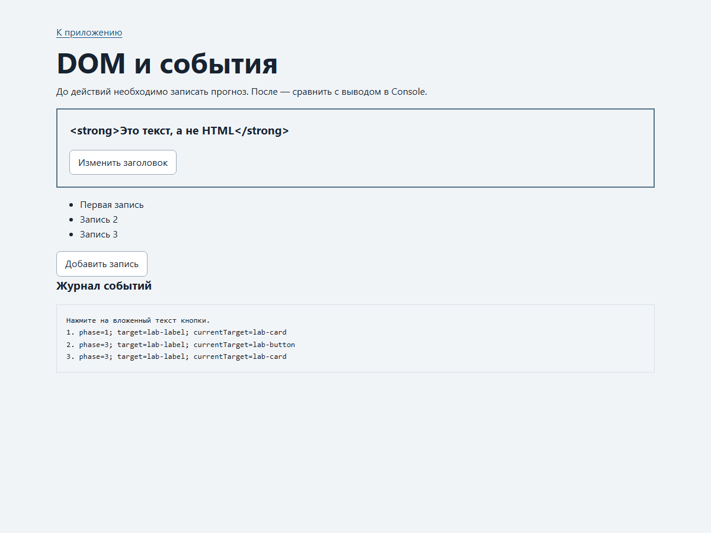
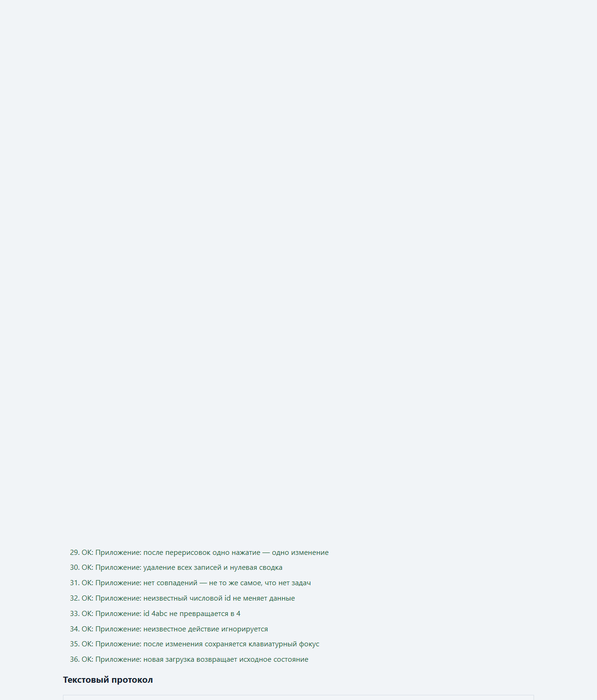
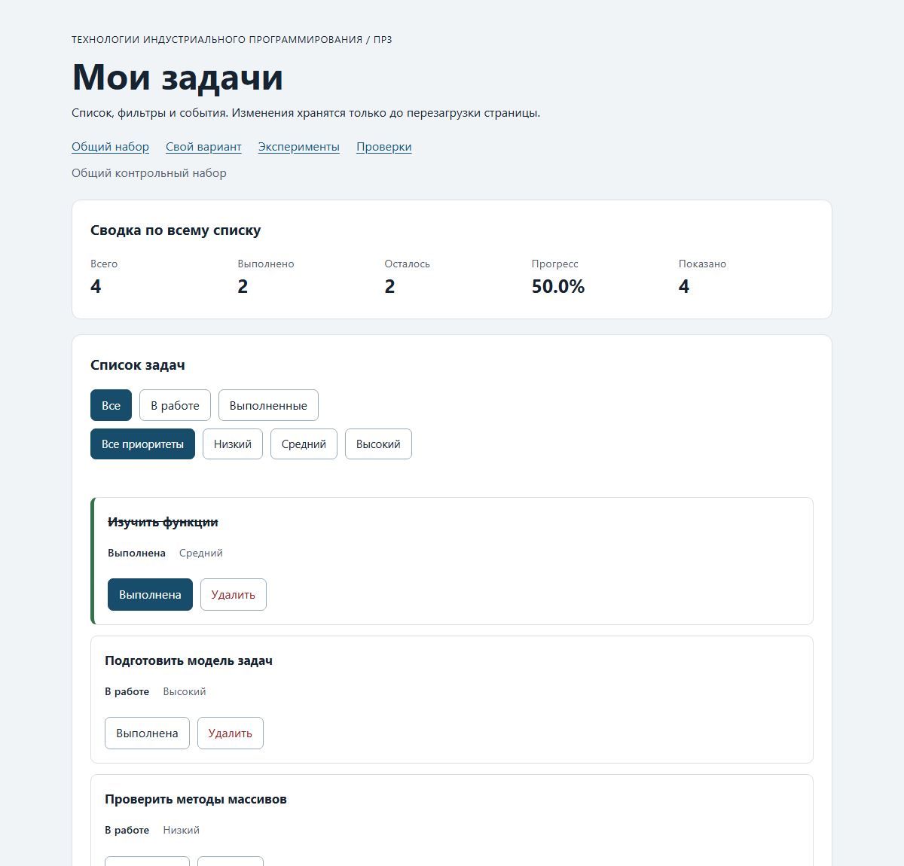
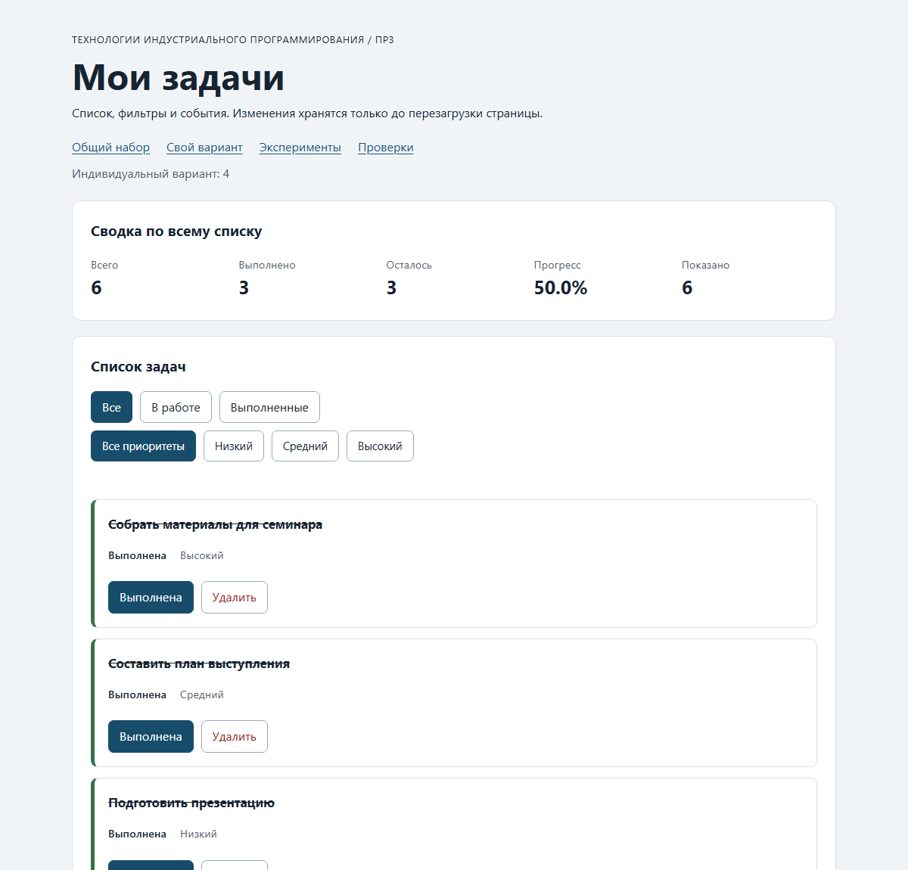

# Практическая работа № 3. Работа с DOM и событиями

## Данные работы

| Поле | Значение |
|---|---|
| Имя | Широбокова Дарья Денисовна |
| Группа | ЭФБО-16-25 |
| Вариант из ПР2 | 4 (подготовка семинара) |
| Node.js | v24.21.0 |
| Браузер | Google Chrome 154.0.8037.98 |
| Операционная система | Windows 11 (10.0.26300) |
| Дата выполнения | 12.10.2026 |

## Запуск

Рабочая папка: `practice-03` внутри личного репозитория.

```bash
npm run check:service   # проверки функций ПР2
npm start               # локальный сервер
```

Устанавливать зависимости через `npm install` не требуется. Для PowerShell при блокировке
`npm.ps1` доступны `npm.cmd` и прямые команды `node`.

```text
http://127.0.0.1:5503/
http://127.0.0.1:5503/index.html?dataset=variant
http://127.0.0.1:5503/examples/dom-events.html
http://127.0.0.1:5503/checks.html
```

Остановка сервера: `Ctrl+C`. Порт не менялся, использован стандартный `5503`. После правки
исходников страница обновляется вручную: автоматической перезагрузки нет.

## Что перенесено из ПР2

`src/task-service.js` и `src/data.js` скопированы из `practice-02` без изменений
(`Copy-Item`), затем проверены внутри ПР3 командой `npm run check:service`: 35 из 35 сценариев
пройдено, исправлений не потребовалось. Модуль `main.js` из ПР2 не переносился: там консольный
сценарий, здесь — управление интерфейсом. Обращений к `document` в `task-service.js` нет.

## Эксперименты

Страница `examples/dom-events.html`, вывод Console и журнал на странице.

| № | До запуска: прогноз | После запуска: результат | Объяснение |
|---:|---|---|---|
| 1. Отсутствующий элемент и коллекция | `null` и пустая коллекция | `Отсутствующий элемент: null`, `Пустая коллекция: 0` | `querySelector` возвращает `null`, `querySelectorAll` — всегда `NodeList`, при отсутствии совпадений пустой. Обращение к свойству `null` вызвало бы `TypeError`, поэтому результат проверяют. |
| 2. dataset и числовой id | `"23"` строкой, затем `23` числом | `dataset.taskId: 23 string`, `Числовой id: 23` | `dataset` всегда отдаёт строку; `Number("23")` даёт число, которое уже можно проверять через `Number.isSafeInteger`. |
| 3. Статический NodeList | Сохранённая длина не изменится | `Исходная длина NodeList: 1`; после двух нажатий `Старый NodeList: 1` и `Новый querySelectorAll: 3` | `querySelectorAll` возвращает статическую коллекцию: она не обновляется при добавлении узлов, для нового снимка нужен новый запрос. |
| 4. Строка с HTML-разметкой | Текст со скобками, элемент не создаётся | Заголовок содержит строку `<strong>Это текст, а не HTML</strong>` | Использован `textContent`: значение выводится как текст, `strong` из строки не создаётся. |
| 5. Распространение события | Три записи: захват, кнопка, всплытие | `1. phase=1; target=lab-label; currentTarget=lab-card`, `2. phase=3; target=lab-label; currentTarget=lab-button`, `3. phase=3; target=lab-label; currentTarget=lab-card` | Нажатие выполнено по вложенному `span#lab-label`. Сначала сработал захват на контейнере (`phase=1`), затем при всплытии — обработчик кнопки и обработчик контейнера (`phase=3`). `target` всё время указывает на `span`, `currentTarget` меняется. |



При отладке обработчика кнопки в точке останова зафиксировано: `event.target` — `span#lab-label`,
`event.currentTarget` — `button#lab-button`, `event.eventPhase` — `2` для цели и `3` при всплытии.
Именно поэтому обработчик контейнера получает нажатие по вложенному элементу: событие всплывает
от `span` к кнопке и далее к контейнеру, а `event.target` при этом не меняется.

## Организация кода

| Модуль | Ответственность |
|---|---|
| `src/task-service.js` | проверенные функции ПР2; работает с переданным массивом |
| `src/task-selectors.js` | `getVisibleTasks(tasks, filter)` — выборка по статусу, новый массив |
| `src/task-extra.js` | расширение: `filterByPriority(tasks, priority)` |
| `src/task-view.js` | `createTaskElement`, `renderTaskList`, `renderSummary`, `renderEmptyState` |
| `src/main.js` | состояние, распознавание событий, вызовы сервиса и отрисовки |

Полный список хранится в `currentTasks`, выбранный статус — в `currentFilter`, приоритет —
в `currentPriority`. При выборе фильтра изменяется только `currentFilter`, а `currentTasks`
не заменяется. События обрабатываются делегированно на контейнерах `ul#task-list`,
`div#task-filters` и `div#priority-filters`; подписки выполняются один раз вне `renderApp`.
Сводка считается в `task-service.js` (`getTaskStats`) по полному массиву, а «Показано» —
по длине видимой выборки.

## Общий сценарий

Сценарий раздела 6.5 методички пройден по шагам; ниже — фактические результаты, полученные
реальными нажатиями в браузере.

| Шаг | Видимые id | Всего | Выполнено | Осталось | Прогресс | Показано | Сообщение | Совпало с ожиданием |
|---:|---|---:|---:|---:|---:|---:|---|---|
| 0 | `[1, 4, 7, 10]` | 4 | 2 | 2 | 50.0% | 4 | скрыто | Да |
| 1 | `[4, 7]` | 4 | 2 | 2 | 50.0% | 2 | скрыто | Да |
| 2 | `[7]` | 4 | 3 | 1 | 75.0% | 1 | скрыто | Да |
| 3 | `[1, 4, 7, 10]` | 4 | 3 | 1 | 75.0% | 4 | скрыто | Да |
| 4 | `[1, 4, 10]` | 3 | 3 | 0 | 100.0% | 3 | скрыто | Да |
| 5 | `[]` | 3 | 3 | 0 | 100.0% | 0 | Нет задач по выбранному фильтру. | Да |
| 6 | `[1, 4, 10]` | 3 | 2 | 1 | 66.7% | 3 | скрыто | Да |
| 7 | `[]` | 0 | 0 | 0 | 0.0% | 0 | Список задач пуст. | Да |

Шаги: 0 — исходный набор; 1 — фильтр «В работе»; 2 — задача `id = 4` отмечена выполненной;
3 — фильтр «Все»; 4 — удалена задача `id = 7`; 5 — фильтр «В работе» (совпадений нет);
6 — фильтр «Все» и переключение `id = 1`; 7 — последовательное удаление `1`, `4`, `10`.
После удаления всех задач фильтр «В работе» сохраняет сообщение «Список задач пуст.», потому
что пуст сам набор, а не результат отбора.

**После перезагрузки:** состояние возвращается к шагу 0 (`[1, 4, 7, 10]`, 4 / 2 / 2, 50.0%).
Сохранение данных в ПР3 не предусмотрено.

Дополнительно проверено: несколько переключений фильтров подряд не накапливают обработчики —
одно нажатие изменяет ровно одну запись; повторная отрисовка не увеличивает число карточек.

## Индивидуальный вариант

Тот же вариант 4 и тот же `variantTasks`, что в ПР2: шесть задач `[11, 23, 37, 41, 58, 64]`,
тема «Подготовка семинара», исходно выполнены первые три, приоритеты включают `low`,
`medium` и `high`.

| Этап | Всего | Выполнено | Осталось | Прогресс | Видимые id |
|---|---:|---:|---:|---|---|
| До действий | 6 | 3 | 3 | 50.0% | `[11, 23, 37, 41, 58, 64]` |
| После переключения 23 | 6 | 2 | 4 | 33.3% | `[11, 23, 37, 41, 58, 64]` |
| После удаления 37 | 5 | 1 | 4 | 20.0% | `[11, 23, 41, 58, 64]` |
| Итог, фильтр «В работе» | 5 | 1 | 4 | 20.0% | `[23, 41, 58, 64]` |
| Итог, фильтр «Выполненные» | 5 | 1 | 4 | 20.0% | `[11]` |

Задача `23` была выполнена, поэтому переключение сняло статус: выполненных стало 2 из 6.
После удаления выполненной задачи `37` осталось 5 записей и одна выполненная — 20.0%.
Название задачи `23` после переключения не изменилось, приоритеты остальных записей сохранены.
Итоговый прогресс `20.0%` совпал с контрольным значением таблицы варианта 4 из методички.

## Протокол проверки сервиса

Команда `npm run check:service`, фактический вывод:

```text
OK: 01. Создание задачи с явным приоритетом
OK: 02. Приоритет по умолчанию
OK: 03. Удаление краевых пробелов без изменения внутренних
OK: 04. Граничные длины названия и положительный безопасный id
OK: 05. Некорректные названия при создании
OK: 06. Некорректные идентификаторы при создании
OK: 07. Все допустимые приоритеты и отклонение недопустимых
OK: 08. Каждый вызов createTask возвращает новый объект
OK: 09. Поиск по id, а не по индексу
OK: 10. Отсутствующая задача и пустой массив при поиске
OK: 11. Поиск не преобразует строковый id в число
OK: 12. Получение невыполненных задач
OK: 13. Пустой список, все выполнены и все не выполнены
OK: 14. Названия в исходном порядке и пустой список
OK: 15. Сводка по общему набору
OK: 16. Сводка по пустому списку
OK: 17. Сводка: ничего не выполнено и выполнено всё
OK: 18. Процент остаётся числом без предварительного округления
OK: 19. Добавление в конец без изменения входного массива
OK: 20. Добавление в пустой список с приоритетом по умолчанию
OK: 21. Повторяющийся id отклоняется
OK: 22. Добавление не обходит проверки createTask
OK: 23. Изменение completed в обе стороны
OK: 24. completed принимает только boolean
OK: 25. Некорректный или отсутствующий id при изменении статуса
OK: 26. Повторная установка статуса создаёт новый результат
OK: 27. Переименование сохраняет остальные поля
OK: 28. Проверки названия при переименовании
OK: 29. Некорректный или отсутствующий id при переименовании
OK: 30. Удаление по id с сохранением порядка
OK: 31. Удаление единственной записи
OK: 32. Некорректный, отсутствующий id и удаление из пустого списка
OK: 33. Входные объекты не изменяются ни одной операцией
OK: 34. Общий сценарий и все промежуточные сводки
OK: 35. Работа с другим набором, без зависимости от demoTasks

Проверок пройдено: 35; не пройдено: 0.
```

Полный вывод сохранён в [`checks/service-checks-output.txt`](./checks/service-checks-output.txt).

## Протокол браузерных проверок

Страница `checks.html`, блок «Текстовый протокол», браузер Chrome 154.0.8037.98:

```text
OK: Фильтр all возвращает новый массив в исходном порядке
OK: Фильтр pending выбирает невыполненные задачи
OK: Фильтр completed выбирает выполненные задачи
OK: Все три фильтра работают с пустым списком
OK: Фильтрация не меняет входные записи и их порядок
OK: Карточка — li.task-card с числовым id в dataset
OK: Статус невыполненной карточки и aria-pressed согласованы
OK: Статус выполненной карточки и aria-pressed согласованы
OK: В карточке две обычные кнопки с вложенными подписями
OK: Все приоритеты отображаются по установленному словарю
OK: Название с разметкой отображается текстом
OK: Отрисовка списка создаёт карточки в исходном порядке
OK: Повторная отрисовка не накапливает карточки
OK: Контейнер списка и его обработчик сохраняются
OK: Отрисовка пустого массива очищает прежние карточки
OK: Сводка считается по всему списку, отдельно выводится Показано
OK: Пустая сводка не содержит NaN и Infinity
OK: Сообщение для полностью пустого списка
OK: Сообщение для пустого результата фильтра
OK: Появление карточек скрывает прежнее пустое состояние
OK: Приложение: начальный набор и сводка
OK: Приложение: фильтр срабатывает по клику на вложенный span
OK: Приложение: активный фильтр отмечен классом и aria-pressed
OK: Приложение: фильтрация не удаляет скрытые задачи
OK: Приложение: переключение по id, а не индексу массива
OK: Приложение: выполненная задача исчезает из фильтра В работе
OK: Приложение: удаление изменяет данные, а не только DOM
OK: Приложение: клик по названию не изменяет данные
OK: Приложение: после перерисовок одно нажатие — одно изменение
OK: Приложение: удаление всех записей и нулевая сводка
OK: Приложение: нет совпадений — не то же самое, что нет задач
OK: Приложение: неизвестный числовой id не меняет данные
OK: Приложение: id 4abc не превращается в 4
OK: Приложение: неизвестное действие игнорируется
OK: Приложение: после изменения сохраняется клавиатурный фокус
OK: Приложение: новая загрузка возвращает исходное состояние

Всего: 36. Пройдено: 36. Ошибок: 0.
```

Полный вывод сохранён в [`checks/browser-checks-output.txt`](./checks/browser-checks-output.txt).



## Собственные проверки

| № | Исходное состояние и действия | Ожидаемый результат | Фактический результат | Итог |
|---:|---|---|---|---|
| 1 | Общий набор, фильтр «В работе», отметить `id = 4` выполненной (граничное состояние: в выборке остаётся одна запись) | Видима только `id = 7`; сводка 4 / 3 / 1 / 75.0%; «Показано» 1 | `[7]`; 4 / 3 / 1 / 75.0%; показано 1; активен фильтр «В работе» | Пройдено |
| 2 | Фильтр «В работе», удалить `id = 7` (событие и повторная отрисовка) | Список пуст, сообщение «Нет задач по выбранному фильтру.», общая сводка по 3 задачам | `[]`; сообщение показано; 3 / 3 / 0 / 100.0%; фокус перешёл на активный фильтр | Пройдено |
| 3 | Проверить `data-task-id="777"` и `data-task-id="4abc"` в панели Elements, затем выполнить действие | Некорректный и отсутствующий id дают сообщение, данные не меняются | «Задача с идентификатором 777 не найдена» и «Некорректный идентификатор задачи: 4abc»; сводка осталась 4 / 2 / 2 / 50.0% | Пройдено |
| 4 | Название длиной 100 символов и название с разметкой `<strong>Проверка</strong>` | Текст выводится полностью, разметка не создаёт элементов | Название отображается целиком; у `.task-title` нет дочерних элементов | Пройдено |
| 5 | Пять быстрых переключений фильтров, затем одно действие | Одно нажатие изменяет ровно одну задачу, обработчики не накапливаются | Сводка изменилась один раз: 4 / 3 / 1 / 75.0% | Пройдено |

Проверка 1 относится к граничному состоянию, проверки 2 и 5 — к работе события и повторной
отрисовке. Сценарии выполнялись вручную в браузере и подтверждаются автоматическими
сценариями 25, 26, 29, 30 и 35 из `checks.html`.

## Отладка и клавиатура

Точка останова ставится на строке чтения идентификатора в `handleTaskListClick`:

```js
const id = Number(card.dataset.taskId);
```

Значения на этой строке: `event.target` — нажатый `span.action-label`, `event.currentTarget` —
контейнер `ul#task-list`, `card.dataset.taskId` — строка `"4"`, `id` после `Number` — число `4`,
действие — `"toggle"`, найденная запись — `{ id: 4, title: "Подготовить модель задач",
completed: false, priority: "high" }`. Следующая остановка — после вызова сервиса: `result.ok`
равно `true`, `result.tasks` — новый массив из четырёх записей, где изменена только запись
`id = 4`, после чего вызывается `renderApp()`.

Ошибочные значения не приводят к изменению данных: для `data-task-id="777"` выводится
«Задача с идентификатором 777 не найдена», для `data-task-id="4abc"` — «Некорректный
идентификатор задачи: 4abc», потому что `Number("4abc")` даёт `NaN` и проверка
`Number.isSafeInteger` не проходит. В обоих случаях массив сохраняется, а сообщение очищается
при следующем корректном выборе фильтра.

Клавиатура: действия — настоящие `button type="button"`, поэтому Tab переводит фокус между
кнопками, а Enter и Space активируют их нативно. После перерисовки вызывается
`restoreTaskFocus(id, action)`: фокус возвращается на соответствующую кнопку той же задачи,
а если карточка исчезла (например, задача выполнена в фильтре «В работе») — на активный фильтр.
Автоматический сценарий «после изменения сохраняется клавиатурный фокус» это подтверждает.

## Вид приложения





## Дополнительное задание

Выполнен **вариант А**: дополнительный фильтр по приоритету. Три основные кнопки статуса
остались в `#task-filters`; новая группа размещена отдельно в `#priority-filters`, поэтому
контракт обязательной части не изменился. Логика отбора вынесена в отдельный модуль
[`src/task-extra.js`](./src/task-extra.js).

Правила поведения:

- кнопки «Все приоритеты», «Низкий», «Средний», «Высокий» работают совместно с фильтром статуса;
- общая сводка по-прежнему считается по полному массиву, «Показано» — по совместной выборке;
- пустой результат совместного отбора показывает «Нет задач по выбранному фильтру.»;
- активная кнопка приоритета отмечается классом `is-active` и `aria-pressed="true"`;
- после изменения задачи выбранный приоритет сохраняется.

| № | Действия | Ожидание | Фактический результат | Итог |
|---:|---|---|---|---|
| 1 | Фильтр «В работе» + «Высокий» | Только невыполненные высокого приоритета | `[4]`; 4 / 2 / 2 / 50.0%; показано 1 | Пройдено |
| 2 | «В работе» + «Низкий» | Только невыполненные низкого приоритета | `[7]`; 4 / 2 / 2 / 50.0%; показано 1 | Пройдено |
| 3 | «Выполненные» + «Низкий» | Совпадений нет | `[]`; сообщение «Нет задач по выбранному фильтру.»; общая сводка не обнулилась | Пройдено |
| 4 | Вернуть оба фильтра в «Все» | Исходный список | `[1, 4, 7, 10]`; 4 / 2 / 2 / 50.0% | Пройдено |
| 5 | Отметить `id = 4` выполненной при активном приоритете | Выбор фильтра сохраняется, меняется только одна запись | `[1, 4, 7, 10]`; 4 / 3 / 1 / 75.0% | Пройдено |

## Вывод

Интерфейс связан с данными ПР2 без дублирования прикладной логики: изменение состояния
происходит только через `setTaskCompleted` и `removeTask`, а DOM перестраивается из нового
массива. Понятия «изменить данные» и «изменить DOM» различаются принципиально: удаление
`<li>` не удаляет задачу, и после отрисовки она вернулась бы. Отбор по фильтру не изменяет
`currentTasks`, поэтому кнопка «Все» возвращает скрытые записи, а общая сводка не зависит от
выбранного фильтра. Ошибки обработчика (неизвестный, некорректный или отсутствующий
идентификатор) оставляют данные без изменений и показывают понятное сообщение.

## Самопроверка

- [x] ПР3 добавлена без удаления предыдущих работ.
- [x] Перенесены собственные проверенные `task-service.js` и `data.js` из ПР2.
- [x] Проект запускается через локальный HTTP-сервер по инструкции.
- [x] Выполнены и описаны пять экспериментов.
- [x] Карточки создаются DOM-методами, названия выводятся как текст.
- [x] Повторная отрисовка не дублирует карточки и сохраняет контейнер списка.
- [x] Действия обрабатываются делегированно, в том числе по вложенной подписи.
- [x] Удаление и изменение статуса вызывают функции ПР2.
- [x] Фильтры не уничтожают скрытые записи; активное состояние согласовано.
- [x] Общая сводка и «Показано» считаются по разным наборам.
- [x] Различаются пустой список и отсутствие совпадений по фильтру.
- [x] Некорректный и отсутствующий идентификаторы не повреждают данные.
- [x] Получены фактические результаты 35 проверок сервиса и 36 браузерных проверок.
- [x] Добавлены собственные случаи и заполнен отчёт.
